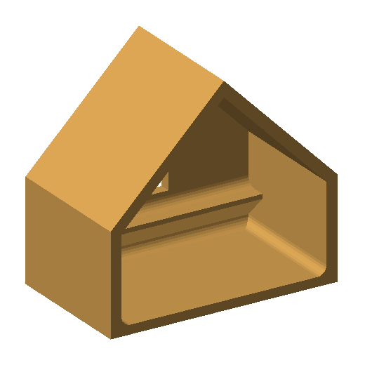

# Worked example: a waiting shelter

A small part built from code to the rules in the skill. It prints upright, floor on the bed, without supports, and passes every automated check with no warnings.



- [`shelter.py`](shelter.py): the generator. Every size is a named constant.
- `shelter.stl`: its output, in print orientation.
- [`passing-report.json`](passing-report.json): the check command's report for that STL.

```
python examples/shelter/shelter.py --preview
```

writes the STL and the picture. It needs only the packages the checks use.

## Which rule each feature follows

| Feature | Rule |
|---|---|
| Walls 2.4 mm thick | Well over the minimum width; thick enough to carry the roof |
| Roof at 45 degrees, grown out of the walls in one outline | A top surface is flat or at least 35 degrees steep. Its underside is a 45 degree overhang, so it needs no support, and there is no eave hanging in the air |
| Round fillets where the side walls and the back wall meet the floor | Horizontal inner corners get a fillet |
| Bench as a corbel that leaves the wall at 45 degrees | No flat underside for a support to grab, and no sharp crevice at the floor |
| Fillet where the bench top meets the wall | Horizontal inner corner again |
| Window with a pointed head | Two 45 degree sides instead of a flat bridge |
| No brim, no added foot | The floor is the widest part |

## What the corner report lists, and why it is left

The corner check is a report, not a verdict. On this part it lists four horizontal corners and counts two vertical ones:

- **The ridge inside the roof** (27.6 mm). Two 45 degree undersides meet there. A corner that faces down gets chamfers, not a round fillet, and this one is made of nothing else.
- **Three edges of the window opening** (2.4 mm each, the wall thickness). Left square: a window reveal.
- **Two vertical corners** where the back wall meets the side walls. Vertical fillets are optional; left square here to keep the outline simple.

## Not shown

The part was generated and checked, not printed. The saved report includes a slicer run.
